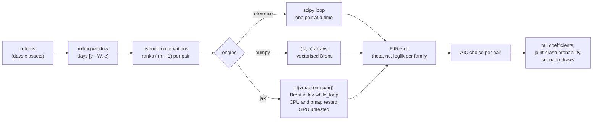

# batch-copula-fitting-jax

[](https://github.com/Avinash186200/batch-copula-fitting-jax/actions/workflows/ci.yml)
[](LICENSE)


Fit eleven bivariate copula families to thousands of asset pairs at once by maximum likelihood, pick one per pair by AIC, and read off tail dependence: a scipy reference loop, a vectorised NumPy engine and a JAX `jit` + `vmap` engine that agree to stated tolerances, with checks on parameter recovery, model choice and joint-crash probabilities.

GPU-capable through JAX, but untested on a GPU: every number here is CPU.

## Scenario

A risk team fits bivariate dependence models every night for thousands of asset pairs: pairs-trading candidates, stress-test pairs, and a tail co-movement report. Two problems. Fitting the models one pair at a time with scipy is too slow for the batch window. And the default model, Gaussian correlation, has zero tail dependence by construction, so it understates how often two assets crash on the same day.

This is a scenario to frame the work. All data here is synthetic, generated in this repo from known copulas, so every fit can be checked against the truth and every number can be rebuilt.

## What it does

| part | what I built | how it is judged |
|---|---|---|
| families | Gaussian, Student-t, Clayton, Gumbel, Frank, and the 180 / 90 / 270 degree rotations of Clayton and Gumbel (11 in all): log-densities, Kendall's tau, closed-form tail coefficients, CDFs, samplers; rank pseudo-observations | each density matches the mixed derivative of its CDF and integrates to 1; samplers hit their Kendall's tau; tail coefficients match C(q, q)/q as q goes to 0 |
| solver | Brent's bounded minimiser written without branches, so it runs on NumPy arrays (all pairs step together) or inside `lax.while_loop` under `vmap` | same minimiser and the same number of function evaluations as `scipy.optimize.minimize_scalar(method="bounded")` |
| engines | `reference`: scipy, one pair at a time (2-D L-BFGS-B for t). `numpy`: (N, n) arrays. `jax`: one pair's recipe, `vmap`-ed and `jit`-compiled, float64, chunked, `pmap` over several devices | batch rho / theta within 1e-4 and log-likelihood within 1e-6 of the reference, same AIC choice, asserted in tests |
| t copula | profile likelihood (outer Brent over log nu, inner over rho); a Student-t quantile for JAX (continued fraction + Newton in log space); a rank-grid shortcut that inverts n/2 points per trial nu instead of 2n | quantile within 1e-9 of `scipy.special.stdtrit`; t log-likelihood never more than 1.1e-7 below the 2-D reference optimum (observed on 54 pairs) |
| experiments | recovery vs sample size, AIC confusion matrix, closed-form vs empirical tail dependence, Gaussian vs t joint-crash probabilities, a rolling-window demo through a stress regime with a pair VaR / ES scenario | held-out seeds; CI reruns everything and compares with the committed JSON |
| throughput | pairs per second against N per engine, with machine details | reported, never asserted |

## How it works



Every engine runs the same log-density code: the formulas in `families.py` are written against a small namespace that is either NumPy + scipy or `jax.numpy` + JAX special functions. Only the loop around them changes. The JAX engine writes the fit for one pair and lets `vmap` batch it, including Brent's data-dependent iterations (each pair keeps stepping until it converges; `vmap` masks the finished ones).

## Results

All numbers below are from synthetic data, copied from [results/RESULTS.md](results/RESULTS.md). `make bench` rebuilds sections 1 to 5 in about 80 seconds on a laptop CPU, and CI checks that a fresh run matches the committed JSON (versions pinned in `constraints.txt`). Throughput (section 6) comes from `make speed`, depends on the machine, and CI never checks it. Every experiment uses held-out seeds; development seeds were used while building (see [docs/methodology.md](docs/methodology.md)). Every solve reports whether it converged: in sections 1 to 5 no batch fit stopped at Brent's 500-iteration cap (`pairs_hit_iteration_cap` is 0 in every results file), and the scipy reference's L-BFGS-B reported no success on a few of the 54 agreement pairs (`reference_pairs_not_converged`: 1 on Windows, 3 on Linux CI; this flag depends on the platform's floating point, so the reproduce test does not compare it), and those pairs still met the agreement tolerances.

### 1. Parameter recovery

The true family fitted to 100 simulated pairs per row, Kendall's tau 0.5 (t: nu = 4). Selected rows; all 27 are in RESULTS.md.

| family | true parameter | n | pairs | bias | RMSE | sqrt(n) x RMSE | tau RMSE |
|---|---|---|---|---|---|---|---|
| Gaussian | rho 0.7071 | 250 | 100 | +0.0046 | 0.0343 | 0.54 | 0.0312 |
| Gaussian | rho 0.7071 | 4000 | 100 | +0.0007 | 0.0081 | 0.51 | 0.0073 |
| t | rho 0.7071 | 250 | 100 | +0.0032 | 0.0379 | 0.60 | 0.0340 |
| t | rho 0.7071 | 4000 | 100 | -0.0021 | 0.0108 | 0.68 | 0.0097 |
| Clayton | theta 2 | 250 | 100 | +0.0704 | 0.2415 | 3.82 | 0.0287 |
| Clayton | theta 2 | 4000 | 100 | -0.0088 | 0.0670 | 4.23 | 0.0085 |
| Gumbel | theta 2 | 250 | 100 | +0.0310 | 0.1373 | 2.17 | 0.0329 |
| Gumbel | theta 2 | 4000 | 100 | +0.0062 | 0.0338 | 2.14 | 0.0084 |
| Frank | theta 5.7363 | 250 | 100 | -0.0291 | 0.5530 | 8.74 | 0.0307 |
| Frank | theta 5.7363 | 4000 | 100 | +0.0142 | 0.1329 | 8.40 | 0.0073 |

- **The estimators converge at the usual rate.** sqrt(n) x RMSE stays roughly flat from n = 250 to 4,000 for every family (for example Gumbel 2.17, 2.02, 2.14), so the error falls like 1/sqrt(n).
- **Small-sample bias is upward for the Archimedean parameters** (Clayton +0.070 at n = 250, +0.017 at 1,000) and is gone by n = 4,000. On the tau scale every bias is below 0.008.
- **nu is the hard parameter.** At n = 250 the t fits give a median nu of 4.07 but an interquartile range of 3.23 to 5.42; at n = 4,000 the range is 3.74 to 4.25. A year of daily data says "heavy tails" but not much more precisely than that.

### 2. Batch engines agree with the scipy reference

54 pairs (6 per true family), n = 500, all 11 families fitted by every engine. Tests assert the tolerances on a separate sample.

| engine | max abs diff, parameter (1-param families) | max abs diff, log-likelihood (1-param) | max abs diff, t rho | t log-likelihood minus reference (min / max) | same AIC choice |
|---|---|---|---|---|---|
| numpy | 1.4e-06 | 6.6e-11 | 1.3e-05 | -1.1e-07 / +2.6e-06 | 54 / 54 |
| jax | 7.5e-06 | 2.1e-10 | 1.3e-05 | -1.1e-07 / +2.6e-06 | 54 / 54 |

Asserted tolerances: 1e-4 on parameters and 1e-6 on log-likelihoods (one-parameter families); 1e-4 on t's rho, and the batch t log-likelihood must not fall more than 1e-6 below the reference. Log-likelihoods are totals over the 500 observations.

- For one-parameter families the reference uses the same Brent algorithm, so agreement mostly confirms the vectorised and JAX implementations (the largest parameter gap, 7.5e-6, sits in a flat likelihood: the largest log-likelihood gap is 2.1e-10).
- For t the reference is a different optimiser (a 2-D L-BFGS-B). The batch profile fit is never more than 1.1e-7 below the reference on any of the 54 pairs, and up to 2.6e-6 above it. nu itself differs by up to 0.4% (`diff_max_t_rel_nu` in `results/agreement.json`) because the likelihood is very flat in nu.

### 3. AIC picks the right family most of the time, and the right tail almost always

100 pairs per true family, tau drawn from U(0.2, 0.7), all 11 candidates.

| n | pairs | accuracy | tail-class accuracy | Gaussian | t | Clayton | Clayton 180 | Gumbel | Gumbel 180 | Frank | Clayton 90 | Gumbel 90 |
|---|---|---|---|---|---|---|---|---|---|---|---|---|
| 250 | 900 | 0.810 | 0.902 | 0.69 | 0.71 | 0.86 | 0.92 | 0.77 | 0.76 | 0.90 | 0.89 | 0.79 |
| 1000 | 900 | 0.976 | 0.988 | 0.94 | 0.97 | 1.00 | 0.98 | 0.99 | 0.98 | 0.99 | 0.99 | 0.94 |

Tail-class accuracy counts a pick as right when the selected family has tail dependence in the same corners as the true one (a Clayton true pair fitted as a survival Gumbel is right; as a Gaussian it is not).

- **At n = 250 (one year of daily data) the hardest calls are Gaussian vs t.** 14 of 100 true t pairs were called Gaussian and 9 of 100 Gaussian pairs were called t. The other common confusions keep the tail: Clayton vs survival Gumbel (13 and 14 pairs), Gumbel vs survival Clayton (16 and 8). Full confusion matrices are in RESULTS.md.
- At n = 1,000 accuracy is 97.6%; the remaining errors are mostly Gaussian called t (6) and Gumbel 90 called Clayton 270 (4).

### 4. Tail dependence: Gaussian misses joint crashes, t does not

Truth: a t copula with rho = 0.7071 and nu = 4 (Kendall's tau 0.5, lambda = 0.397). 100 samples of n = 1,000, each fitted with Gaussian and t. AIC prefers t in 100 of 100.

| q | true P(both below their q-quantile) | if independent | Gaussian fit (mean) | t fit (mean) | Gaussian / true | t / true |
|---|---|---|---|---|---|---|
| 0.01 | 0.00432 | 0.00010 | 0.00266 | 0.00433 | 0.616 | 1.001 |
| 0.05 | 0.02409 | 0.00250 | 0.01956 | 0.02409 | 0.812 | 1.000 |

- The fitted Gaussian has almost the same correlation (mean rho 0.6987 vs 0.7052 for the t fit) and still puts **38% less probability on a joint 1-in-100-day crash**. The gap widens further into the tail, because the Gaussian lambda is exactly 0 while the t fits average 0.395 (truth 0.397).

The empirical estimator lambda_L(q) = #{u <= q, v <= q} / (n q), at n = 20,000 (mean and sd over 100 samples):

| family (tau 0.5) | closed-form lambda_L | empirical, q = 0.01 | exact C(q,q)/q, q = 0.01 | empirical, q = 0.05 | exact C(q,q)/q, q = 0.05 |
|---|---|---|---|---|---|
| Gaussian | 0 | 0.273 (0.037) | 0.273 | 0.399 (0.020) | 0.398 |
| t (nu 4) | 0.397 | 0.437 (0.044) | 0.432 | 0.480 (0.022) | 0.482 |
| Clayton | 0.707 | 0.690 (0.064) | 0.707 | 0.712 (0.029) | 0.708 |
| Gumbel | 0 | 0.152 (0.025) | 0.148 | 0.291 (0.019) | 0.289 |
| Frank | 0 | 0.054 (0.017) | 0.054 | 0.226 (0.015) | 0.225 |

- **The empirical estimator is not a tail-dependence test at practical q.** For a Gaussian copula with tau 0.5 it reads 0.27 at q = 0.01, although the true limit is 0: at finite q it estimates C(q, q)/q (which it does well), and for the Gaussian that only creeps toward 0. A parametric fit with the right family gives the limit directly; the price is the model risk that section 3 measures.
- **One sample is noisy.** At q = 0.01 a sample of 20,000 has about 200 points in each tail, so a single estimate scatters by the sd column (0.064 for Clayton); even the mean over 100 samples sits 0.017 below Clayton's exact 0.707.

### 5. Demo: rolling fits through a stress regime

A synthetic 10-asset, 1,500-day panel: calm days have a Gaussian copula (rho 0.3, no tail dependence); days 750 to 1,049 are a stress regime with a Clayton copula (theta 2: lambda_L 0.707) and higher volatility. Rolling 250-day windows every 25 days, all 45 pairs: 51 windows, 2,295 fits. Each window uses only its own past 250 days. Probability that both assets fall below their own 4% quantile on the same day (4% of 250 is exactly 10 days; with 5%, ranks / 251 <= 0.05 would select 12 days, a 4.8% tail, and bias the empirical column):

| window phase | windows | pairs with a lower-tail family | mean lambda_L (selected) | joint-crash prob.: empirical | selected family | Gaussian fit | truth |
|---|---|---|---|---|---|---|---|
| calm, before | 21 | 18.6% | 0.036 | 0.0048 | 0.0053 | 0.0050 | 0.0050 |
| mixed | 18 | 96.5% | 0.481 | 0.0221 | 0.0201 | 0.0109 | - |
| stress | 3 | 100% | 0.677 | 0.0279 | 0.0271 | 0.0136 | 0.0283 |
| calm, after | 9 | 10.9% | 0.020 | 0.0047 | 0.0051 | 0.0053 | 0.0050 |

Stress scenario: the last window wholly inside the stress block, a 50/50 portfolio for each pair, the same empirical marginals for every row, 100,000 draws per pair, averaged over the 45 pairs (99% one-day VaR and ES, fraction of position):

| copula used | VaR 99% | ES 99% |
|---|---|---|
| true stress copula (Clayton) | 0.0468 | 0.0523 |
| AIC-selected fit on the stress window | 0.0464 | 0.0520 |
| Gaussian fitted on the stress window | 0.0420 | 0.0478 |
| Gaussian fitted on the last calm window | 0.0360 | 0.0414 |

- **The batch fit sees the regime change.** Once a window contains stress days, 96% to 100% of pairs pick a lower-tail family and the selected models' joint-crash probability tracks the empirical one (0.0271 vs 0.0279 in stress windows; truth 0.0283). The Gaussian fit on the same windows says 0.0136, under half of the truth.
- **In the scenario the copula alone moves VaR by 10% to 23%.** A Gaussian fitted to stress data understates VaR by 10%; carrying the calm-period Gaussian into a crisis understates it by 23%.
- **Calm windows show false alarms.** 19% (before) and 11% (after) of calm pairs pick a lower-tail family although the truth is Gaussian; with 250 observations a mild tail family often wins AIC by chance (section 3 shows Gaussian is picked only 69% of the time at n = 250). The mean lambda_L of those picks is small (0.02 to 0.04).

### 6. Throughput

Pairs fitted per second, all 11 families plus the AIC choice per pair, n = 500 observations per pair, mixed true families. Measured with `make speed` and `make speed-multicore` on one laptop (Intel64 family 6 model 170, 22 logical CPUs, Windows build 26200, Python 3.11.9, JAX 0.10.2 on CPU), with other jobs running on the same machine. Each cell is the faster of 2 timed calls after an untimed warm-up call (the reference loop: one timed call, no warm-up). **No GPU numbers:** see Limitations.

| engine | N = 10 | N = 100 | N = 1,000 | N = 4,000 |
|---|---|---|---|---|
| reference (scipy loop) | 5.5 | 5.3 | - | - |
| numpy (vectorised) | 19.6 | 22.2 | 20.5 | - |
| jax, CPU, 1 device | 64.4 | 124.1 | 257.0 | 246.4 |
| jax, CPU, 16 devices (`pmap`) | 32.5 | 335.2 | 400.0 | 374.0 |

The reference was also run at N = 30 (5.4 pairs/s). JAX's first call for a new shape compiles: up to 20 seconds here (`first_call_seconds` in `results/speed_*.json`).

- **JAX on CPU (one XLA device) fits about 48x more pairs per second than the scipy loop** (257 vs 5.3 at N = 1,000). Extrapolating that rate, 500,000 pairs (every pair of a 1,000-asset universe) would take about 32 minutes on this laptop, against about 26 hours for the loop.
- **The vectorised NumPy engine gains only about 4x**, because its t copula calls scipy's `stdtrit` for every trial nu; JAX uses its own fused t quantile.
- **Splitting the CPU into 16 XLA devices adds about 1.6x, not 16x** (400 vs 257 pairs/s at N = 1,000). At N = 10 it is slower, since 16 devices each get padded work.

## Key concepts

- **Copula and Sklar's theorem.** A joint distribution is its marginals plus a copula, the joint distribution of the marginal ranks. Fitting the copula to rank pseudo-observations, ranks / (n + 1), separates dependence from the marginals and is robust to fat-tailed returns.
- **Tail dependence.** lambda_L = lim P(V <= q | U <= q) as q goes to 0: the chance that one asset crashes given that the other does, in the limit. Gaussian copulas have lambda = 0 for any correlation below 1; t copulas have it in both tails; Clayton in the lower tail; Gumbel in the upper; rotations move it to other corners.
- **Maximum likelihood with Brent.** Each one-parameter fit is a smooth 1-D problem on a bracket, so a bounded derivative-free minimiser is enough. Brent mixes golden-section steps (safe) with parabolic steps (fast).
- **Profile likelihood for t.** For each nu, the best rho is found; the outer search is over that profile. One t-quantile evaluation per outer step, and the joint optimum without a 2-D optimiser.
- **vmap over a while loop.** JAX batches a per-pair `lax.while_loop` into one loop over all pairs that runs until the slowest pair converges, with finished pairs masked. That is why the per-pair code can keep Brent's data-dependent control flow.
- **AIC.** 2k - 2 log-likelihood; k = 2 for t and 1 otherwise. It penalises t's extra parameter, which is why borderline Gaussian / t calls go either way at n = 250.
- **Development vs held-out seeds.** Solver settings, tolerances and experiment designs were fixed on development seeds; the committed results come from separate held-out seeds. What changed during development is listed in docs/methodology.md.

## Quick start

```bash
pip install -c constraints.txt -e ".[dev,jax]"   # exact versions the results were made with
pytest -q                                         # a few minutes; includes a full rerun against results/
make bench                                        # results/{recovery,agreement,selection,tail,demo}.json + RESULTS.md
make speed                                        # results/speed_local.json for this machine (git-ignored)
python -m copulabatch.cli fit-csv returns.csv --index-col --window 250   # fit every pair of a CSV
```

The core needs only NumPy and SciPy (`pip install -e .` gives the `reference` and `numpy` engines). JAX is the `jax` extra; PyPI's default jaxlib is CPU-only, which is what CI uses. For a GPU, install a CUDA build of jaxlib on Linux. Usage examples are in [docs/walkthrough.md](docs/walkthrough.md); the rules behind every number are in [docs/methodology.md](docs/methodology.md).

## Layout

```
src/copulabatch/
  families.py     11 families: log-densities, tau, tail coefficients, CDFs, samplers, pseudo-obs
  brent.py        branch-free Brent minimiser (NumPy arrays or one JAX lane)
  objective.py    per-family objectives and the fitting recipe, shared by all engines
  engines.py      reference / numpy / jax engines, FitResult, AIC
  jax_special.py  Student-t cdf and quantile for JAX
  jax_ops.py      the JAX namespace (turns on float64)
  sim.py          simulated pairs and the regime-switching return panel
  bench.py        the experiments behind results/*.json
  speed.py        throughput harness
  report.py       RESULTS.md renderer
  cli.py          copulabatch bench | speed | report | fit-csv
tests/            unit tests per module, a small end-to-end run, a full rerun against results/
results/          JSON results and RESULTS.md (speed_*.json are machine-specific)
docs/             methodology, walkthrough
```

## Limitations

- **Everything is synthetic and in-distribution.** Pairs are drawn from the same eleven families the fitter knows, so the recovery and selection numbers are a best case. Real dependence is often none of these families (asymmetric, BB-type, skewed t), and AIC then only picks the least bad candidate. There is no goodness-of-fit test here.
- **Returns are treated as independent over time.** Pseudo-MLE assumes iid observations. Real daily returns have volatility clustering; the usual fix is to fit GARCH-type marginals and use the copula on standardised residuals. The demo's regimes change volatility and dependence together, and the rank transform absorbs the volatility change only within a window.
- **Bivariate only.** Each pair is fitted on its own; nothing ties the 45 pair copulas into one consistent multivariate model (vines or a multivariate t would). The stress scenario is therefore per pair, not a portfolio-wide simulation.
- **One static copula per window.** No time-varying parameters (for example score-driven models); the rolling window is the only dynamics, and its length trades noise against lag (the "mixed" windows in the demo).
- **Model choice is noisy at one year of data.** At n = 250, Gaussian is picked for only 69% of true Gaussian pairs and t for 71% of true t pairs; in the demo 11% to 19% of calm pairs get a lower-tail family by chance.
- **Brent finds a local optimum on a bracket.** The likelihoods are unimodal in practice for these families and brackets, and the engines agree with an independent optimiser for t, but that is evidence on simulated data, not a proof. Parameters are bounded (for example nu in [2, 50], Clayton theta at most 30); fits at a bound are reported as such (`nu_at_upper_bound` in the recovery JSON), not extended.
- **The stress scenario's marginals are empirical.** They come from 250 stress days, so simulated losses cannot exceed the worst day in the window. That caps ES close to VaR in every row alike; the comparison between copulas is the finding, not the level.
- **No GPU numbers: the GPU path is untested.** The engine code is device-agnostic (`jit`, `vmap`, `pmap`), and it runs in float64, which consumer GPUs execute far slower than float32. Do not read a GPU speed-up into these results.
- **Throughput is one laptop, measured while other jobs were running.** The reference loop is a plain scipy loop with no warm starts; the NumPy engine's t copula is slow because scipy's `stdtrit` is; JAX on CPU runs these kernels on one core per XLA device, and splitting the CPU into 16 devices helped by the factor in the table, not 16x. Treat the table as a comparison on one machine.
- **The committed results were produced on Windows.** CI on ubuntu reruns `make bench` and compares with tolerances (1e-4 relative, 1e-6 absolute). These allow for solver-path differences: a last-bit rounding difference between CPUs can send Brent down a different, equally valid path that stops elsewhere within its tolerance, which in flat likelihoods (nu, Frank theta) moves a parameter by more than the solver tolerance. Each scenario draw has its own generator, so one such difference cannot shift other draws. I could not run the Linux comparison locally before committing.
- **The stress VaR is in-sample, not a backtest.** The copulas are fitted to the same 250-day window whose empirical marginals feed the scenario, and the "true" row uses the known simulation copula. Nothing here tests VaR forecasts on later days.
- **`fit-csv` needs a complete numeric CSV.** It expects a header row, an optional index column and a number in every cell: no missing values, no non-numeric cells, and the same rows for every asset. Clean and align the data first.

## License

MIT. See [LICENSE](LICENSE).
